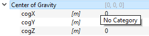
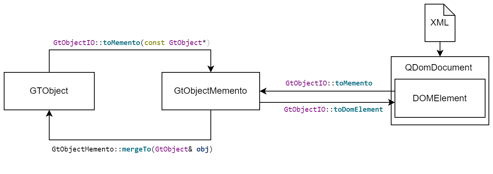

:tocdepth: 3

.. _concepts:

Data Modeling
=============

In GTlab, data modeling revolves around Objects and their associated properties.
Objects serve as the fundamental units of the data structure and contain properties that hold values and metadata.
Each Object is derived from :cpp:class:`GtObject`, which is a QObject, allowing it to leverage Qt’s signal-slot mechanism and hierarchical organization. 
Properties, encapsulated within :cpp:class:`GtAbstractProperty` objects, provide flexibility in handling various data types and units within GTlab’s data framework.

Objects
-------

Objects are the main ingredient to create data hierarchies and data models in GTlab.
They have many features under the hood that allows GTlab to access all objects in a uniform way.

The key characteristics of Objects are:

- Derived from :cpp:class:`GtObject`
- Support a parent-child hierarchy and can contain other Objects as children. The actual content of a Object (i.e., the data) is provided by its Properties.
- Each Object has an unique identifier (UUIDs) and can be referenced via its UUID or a hierarchical path.
- Automatic serialization, deserialization and change detection via :ref:`Object Mementos <Mementos>`.

Hierarchies and Relationship Management
^^^^^^^^^^^^^^^^^^^^^^^^^^^^^^^^^^^^^^^

Objects support an extensive parent-child hierarchy. This hierarchy facilitates efficient data modeling, where each Object can contain multiple children,
enabling complex, multi-layered structures. GTLab provides several methods for managing and navigating these hierarchies:

Query child objects by Type
"""""""""""""""""""""""""""

via :cpp:func:`GtObject::findDirectChildren()`, :cpp:func:`GtObject::findChildren()`,
:cpp:func:`GtObject::findDirectChild()` and :cpp:func:`GtObject::findChild()` directly of in a recursive way. Example:

.. code-block:: cpp
   
   // get the booster
   GtObject* booster = engine->findDirectChild<BoosterType*>();

   // get a specific booster defined by a name
   GtObject* booster2 = engine->findDirectChild<BoosterType*>("Booster2");

   // get all booster
   QList<BoosterType*> allBooster = engine->findDirectChilden<BoosterType*>();
   
To perform a recursive query, including sub-objects, replace ``findDirectChild`` with ``findChild`` etc.

Query child objects  by UUID or path
""""""""""""""""""""""""""""""""""""

To retrieve objects using unique identifiers (UUIDs) or hierarchical paths using both direct and recursive searches,
the functions :cpp:func:`GtObject::getObjectByUuid()` and :cpp:func:`GtObject::getObjectByPath()` are used.

Adding child objects
""""""""""""""""""""

Objects are added to the parent object via :cpp:func:`GtObject::appendChild` at the end of the object or at a specific position via :cpp:func:`GtObject::insertChild`

.. code-block:: cpp
   
   // create a booster
   GtObject* booster = new BoosterType();

   // note, engine becomes owner of booster. Thus no need to manually delete the booster object
   engine->appendChild(booster);

   // and another one
   GtObject* firstBooster = new BoosterType();

   // insert this object at position 0
   engine->insertChild(0, firstBooster);
   

Default vs. Non-Default Child Objects
^^^^^^^^^^^^^^^^^^^^^^^^^^^^^^^^^^^^^

**Non-Default Child Objects:**
Optional objects. Allthough they are also generated during object construction, non-default Objects can be deleted by the user or a project and thus cannot be
assumed to always exist.

**Default Child Objects:**
A mandatory object. A default child object is an object that will always exist within its parent.
In case a default object is missing in a project, it will be generated by GTlab in the Object constructor.
To make a Object default, call :cpp:func:`GtObject::setDefault`, e.g.

.. code-block:: cpp

   GtObject* booster = new BoosterType();
   booster->setDefault(true);
   ...

Ownership
^^^^^^^^^

- Objects in a hierarchy are always owned by their parent object and are therefore automatically deleted, if the parent is deleted.
- If a object is manually deleted, it will be removed from its parent.

Since ``GtObject`` is based on ``QObject``, it follows the same ownership model and semantics.
More information can be found in the Qt documentation https://doc.qt.io/qt-6/objecttrees.html.

Copying Objects
^^^^^^^^^

There are two ways to duplicate an object (including its children).
Using the ``copy()`` function, new UUIDs are generated for the complete hierarchy of the copied object .
The overload ``copy(GtObjectUUIDMap&)`` can be used if the caller needs a mapping of original -> copied UUIDs for the complete hierarchy.
The ``clone()`` function makes an exact clone and preserves the UUIDs.

.. code-block:: cpp
   
   #include "gt_objectuuidmap.h"
   
   GtObject* obj = new MyDataClass();   
   GtObject* objCopy;

   objCopy = obj->copy();
   //--> obj->uuid() != objCopy->uuid()
   
   GtObjectUUIDMap uuidMap;
   objCopy = obj->copy(uuidMap);
   //--> obj->uuid() != objCopy->uuid()
   //--> uuidMap.copiedUuid(obj->uuid()) == objCopy->uuid()
      
   objCopy = obj->clone();
   //--> obj->uuid() == objCopy->uuid()
      
   
Properties
----------

Properties are an important instrument to make member variables of data model classes visible in the
graphical user interface (GUI) of the GTlab framework and to enable data serialization.

Adding Properties
^^^^^^^^^^^^^^^^^

To extend a data model class with a property, there are some aspects to be considered.

Depending on the property type, a member variable should be added in the header files private section.

.. code-block:: cpp
   
   #include "gt_doubleproperty.h"
   
   class MyDataClass : public GtObject
   {
   ...
   private:
      GtDoubleProperty m_myDoubleProp;
   ...
   };

Furthermore, the member variable needs to be Initialized in the class constructor initializer list.
Please note that a property always requires the specification of an identification string and a name.
The identification string is required for the serialization functionality of the GTlab framework.
It should be short and unique. The name parameter appears in the graphical user interface of the
GTlab framework and should be user readable.

In order to ensure that the property can be recognized by the GTlab framework, the property must also
be registered using the registerProperty() function. By specifying an additional string, the property
can be assigned to a category. The categories are only visualized in the GUI. Properties with the same
category name will appear in the GUI under the same category. Without specifying a category,
the property is automatically assigned to the category "Main". The property category has no influence
on the serialization of the object and can be changed at any time without invalidating saved data.

.. code-block:: cpp
 
   MyDataClass::MyDataClass() 
   : m_myDoubleProp("doubleProp", "My Double Property")
   {
      registerProperty(m_myDoubleProp); // or registerProperty(m_myDoubleProp, "My Property Category")
   }

By properly adding a property to the data model class, the GTlab Framework can manage the associated
parameter autonomously. This includes the ability to serialize, deserialize and compare the property
with another data records.

The entry within the serialized record contains the property identification string, the data type and
the actual value of the property. With this information the IO system of GTlab is able to recreate the
serialized object state. Please note that the values of the properties are always stored in the SI-Unit system.

.. code-block:: xml

   <property name="doubleProp" type="double">106.2</property>

There are some functionalities that are independent of the property type:

Sub-Properties
^^^^^^^^^^^^^^

Properties can be ordered in a hierarchical manner in GTlab's user interface.
For example, a child property can be added to a property via :cpp:func:`GtAbstractProperty::registerSubProperty`.
The hierarchical structure has no influence on the serialization
of the object.

An example of sub-properties is shown in the following screenshot, where
the center of gravity property contains three sub properties - x,y,z:

.. note::

   When registering the properties, please note that all subproperties must be added before
   the main property is registered to the object.

   .. code-block:: cpp

      cog.registerSubProperty(cogX);
      cog.registerSubProperty(cogY);
      cog.registerSubProperty(cogZ);
      registerProperty(cog);

Read-only Properties
^^^^^^^^^^^^^^^^^^^^

A property can be configured so that a modification by the user is not possible.
However, this only affects the modification via the GUI.

To change the visibility of a property, use :cpp:func:`GtAbstractProperty::setReadOnly`.
See also :cpp:func:`GtAbstractProperty::isReadOnly()`.

Example:

.. code-block:: cpp

   m_myDoubleProp.setReadOnly(true);
   registerProperty(m_myDoubleProp);

Hidden Properties
^^^^^^^^^^^^^^^^^

A property can be configured so that the property is not displayed within the GUI.

See :cpp:func:`GtAbstractProperty::hide()` or :cpp:func:`GtAbstractProperty::isHidden()`.

Optional Properties
^^^^^^^^^^^^^^^^^^^

A property can be configured so that the property becomes optional.
As a result, besides the actual value of the property, an additional switch (active/inactive) is added.

See :cpp:func:`GtAbstractProperty::setOptional()`, :cpp:func:`GtAbstractProperty::isOptional()`,
:cpp:func:`GtAbstractProperty::setActive()` and  :cpp:func:`GtAbstractProperty::isActive()`.

Property Connections
^^^^^^^^^^^^^^^^^^^^

A property connection transfers the value of one property (the source) to another property (the target). In a process chain, for example, the monitoring property of a calculator supplies the input property of the next process element. Connections are created in the connection editor of the process environment. Whenever the value of the source property changes, the target property is updated with the value computed by the registered conversion function.

Whether two properties can be connected is decided per property type pair. A *connection compatibility check* (an ``isCompatible`` function) defines which targets are allowed, and a *conversion function* computes the value of the target property, also for pairs with different data types. Both are registered in the property conversion registry, which is accessed via :cpp:func:`gtPropConversion`.

The conversion function only computes the value: both properties are passed as const references. The assignment to the target property is done by the receiving property, which keeps its previous value if the conversion fails.

Making a Property Connectable
"""""""""""""""""""""""""""""

Only properties that are marked as connectable are offered as ports in the connection editor. The standard value properties (``GtDoubleProperty``, ``GtIntProperty``, ``GtBoolProperty``, ``GtStringProperty`` and ``GtObjectLinkProperty``) are connectable by default. Properties without a transferable value, such as ``GtColorProperty``, ``GtLabelProperty`` or ``GtFileChooserProperty``, are not connectable.

In a custom property class the flag can be set or overridden in the constructor:

.. code-block:: cpp

   GtMyProperty::GtMyProperty(const QString& ident, const QString& name)
   {
       ...
       setConnectable();      // allow connections (default)
       // or
       setConnectable(false); // exclude the property from connections
   }

See :cpp:func:`GtAbstractProperty::setConnectable` and :cpp:func:`GtAbstractProperty::isConnectable`.

Checking Connection Compatibility
"""""""""""""""""""""""""""""""""

The function :cpp:func:`GtAbstractProperty::canConnect` checks, based on the registered compatibility functions, whether a given property can serve as target of this property:

.. code-block:: cpp

   bool isAllowed = sourceProp.canConnect(targetProp);

The check is directional: a registration for the pair *A to B* does not allow a connection from *B* to *A*. The connection editor uses this function to mark valid connection targets, and the connection setup itself refuses to create a connection if the check fails.

If no converter is registered for a type pair, an implicit default check applies: the connection is accepted if both properties hold a value of the same type, and the value is transferred without conversion.

.. note::

   The registry follows the metaobject inheritance chain of both properties. A registration for a base type pair, e.g. ``GtDoubleProperty`` to ``GtIntProperty``, also applies to derived types such as ``GtDoubleMonitoringProperty``. If several registrations match, the pair with the smallest sum of the inheritance depths of source and target wins; if the sums are equal, the more specific source type is preferred, followed by the more specific target type. An explicitly registered converter is preferred over the implicit default conversion at the same position.

   For a custom property type, a converter is registered in the constructor of the property class. The registration is global, so a static local variable should be used to ensure that it happens only once.

Registering a Conversion
""""""""""""""""""""""""

The conversion and the compatibility function for a type pair are registered via :cpp:func:`GtPropertyConversionRegistry::registerConnectionCompatibility`. The functions use the following signatures:

.. code-block:: cpp

   // returns true if the source may be connected to the target
   using isCompatible = std::function<bool(GtAbstractProperty const& from,
                                           GtAbstractProperty const& to)>;

   // computes the value of the target property
   using convert = std::function<ConversionResult<QVariant>(
                                                            GtAbstractProperty const& from, GtAbstractProperty const& to)>;

The conversion function returns a ``gt::conversion::ConversionResult`` struct that combines the computed value with a status of the ``gt::conversion::conversionSuccess`` enum:

- ``Success`` — the value has been converted without loss of information
- ``Lossy`` — the value has been converted, but part of the information was lost (a warning is logged)
- ``Failed`` — the value could not be converted, the target property keeps its previous value

As an example, a module registers a conversion from a custom property type to an int property in the ``init()`` function of the module interface:

.. code-block:: cpp

   #include "gt_propertyconversionregistry.h"
   #include "gt_intproperty.h"

   void
   MyModule::init()
   {
       auto& registry = gtPropConversion();

       registry.registerConnectionCompatibility(
           GtMyProperty::staticMetaObject, GtIntProperty::staticMetaObject,
           
               -> gt::conversion::ConversionResult<int> {
               const auto& from = static_cast<const GtMyProperty&>(source);
               const auto& to = static_cast<const GtIntProperty&>(target);

               const int value = from.getVal();

               if (to.lowSideBoundaryActive() && value < to.lowSideBoundary())
               {
                   return gt::conversion::ConversionResult<int>::failed();
               }

               return gt::conversion::ConversionResult<int>::success(value);
           },
            {
               return true;
           });
   }

The typed conversion callable is type-erased by the registry, so the conversion function may return a ``ConversionResult`` of any value type that can be stored in a ``QVariant``.

The ``init()`` function of :cpp:class:`GtModuleInterface` is called on application startup and is a suitable place for a module to register its property conversions. The registry is a global singleton, so the registration is performed once per process. Alternatively, a property class can register its own converter in its constructor, as the standard property types do.

.. note::

   A type pair can only be registered once. If a converter for the pair already exists, the new registration is ignored with a warning.

Built-in Conversions
""""""""""""""""""""

The standard property types are handled by converters that are registered when the registry is created (pairs of different types) and by the property classes themselves (pairs of identical types):

.. list-table::
   :header-rows: 1

   * - From
     - To
     - Compatibility check / conversion
   * - (no registered converter)
     - (any property type)
     - implicit default: connectable if both properties hold a value of the same type; the value is copied without conversion
   * - ``GtDoubleProperty``
     - ``GtIntProperty``
     - always connectable; the value is rounded to the nearest integer. The conversion fails for NaN/Inf values, values outside the range of ``int``, and values outside the active boundaries of the target. Loss of a decimal part or of unit information is reported as *Lossy*.
   * - ``GtIntProperty``
     - ``GtDoubleProperty``
     - always connectable; the value is converted without loss
   * - ``GtIntProperty``
     - ``GtBoolProperty``
     - always connectable; zero is converted to false, any other value to true. Values other than zero and one are reported as *Lossy*.
   * - ``GtBoolProperty``
     - ``GtIntProperty``
     - always connectable; false is converted to zero, true to one. The conversion is lossless.
   * - ``GtDoubleProperty``
     - ``GtDoubleProperty``
     - connectable if the unit categories match (or one of the properties has no unit) and the active value ranges overlap
   * - ``GtIntProperty``
     - ``GtIntProperty``
     - connectable if the active value ranges overlap
   * - ``GtObjectLinkProperty``
     - ``GtObjectLinkProperty``
     - connectable if at least one class allowed on the source is allowed on the target, or vice versa

The converters for pairs of different types are registered when the registry is created, e.g.:

.. code-block:: cpp

   // converter from double to int
   registerConnectionCompatibility(
       GtDoubleProperty::staticMetaObject, GtIntProperty::staticMetaObject,
       gt::conversion::fromDouble::toInt,
       gt::conversion::fromDouble::canConnectToInt);

The converters for pairs of identical types are registered in the constructor of the property class, e.g. ``GtIntProperty`` registers a converter for ``GtIntProperty`` to ``GtIntProperty``. These converters use the default conversion and a type-specific compatibility check.

The *double to int* conversion function shows a typical implementation. It validates the value, respects the boundaries of the target property, and reports information loss:

.. code-block:: cpp

   gt::conversion::ConversionResult<int>
   gt::conversion::fromDouble::toInt(const GtAbstractProperty& source,
                                     const GtAbstractProperty& target)
   {
       const auto& from = static_cast<const GtDoubleProperty&>(source);
       const auto& to = static_cast<const GtIntProperty&>(target);

       double baseValue = from.getVal();

       if (qIsNaN(baseValue) || qIsInf(baseValue))
       {
           return ConversionResult<int>::failed();
       }

       const double rounded = std::round(baseValue);

       if (rounded < std::numeric_limits<int>::lowest() ||
           rounded > std::numeric_limits<int>::max())
       {
           return ConversionResult<int>::failed();
       }

       int result = static_cast<int>(rounded);

       if (to.lowSideBoundaryActive() && result < to.lowSideBoundary())
       {
           return ConversionResult<int>::failed();
       }

       if (to.highSideBoundaryActive() && result > to.highSideBoundary())
       {
           return ConversionResult<int>::failed();
       }

       // Difference to original double
       const double error = std::abs(baseValue - rounded);

       // Tolerance in relation to magnitude of property value
       const double tolerance = std::numeric_limits<double>::epsilon() *
                                std::max(1.0, std::abs(baseValue));

       if (error > tolerance)
       {
           return ConversionResult<int>::lossy(result);
       }

       if (from.unitCategory() != GtUnit::None &&
           from.unitCategory() != GtUnit::NonDimensional)
       {
           gtWarning() << QObject::tr("Conversion from %1 to %2 indicates a loss "
                                      "of the unit information (%3)")
                               .arg(from.objectName(), to.objectName(),
                                    from.unitCategoryToString());

           return ConversionResult<int>::lossy(result);
       }

       return ConversionResult<int>::success(result);
   }

Object Flags
------------

``GtObject`` uses flags to represent object state, GUI behavior, and
serialization-related behavior.

.. list-table::
   :header-rows: 1

   * - Flag
     - Purpose
     - Typical usage
   * - ``HasOwnChanges``
     - Marks that the object itself has changed.
     - Used by change tracking and save logic.
   * - ``HasChildChanges``
     - Marks that at least one child object changed.
     - Used to propagate change state in object trees.
   * - ``NewlyCreated``
     - Marks objects that were created in the current session.
     - Used to distinguish new vs. restored objects.
   * - ``UserDeletable``
     - Allows deletion in the GUI context menu.
     - Set for optional/user-managed child objects.
   * - ``UserRenamable``
     - Allows rename in the GUI context menu.
     - Set for objects where user naming is meaningful.
   * - ``DefaultComponent``
     - Marks mandatory child objects that should always exist.
     - Default children are re-created if missing during restore.
   * - ``UserHidden``
     - Hides objects in the explorer/user-facing tree.
     - Used for technical/internal objects and unresolved child visibility.
   * - ``SaveAsOwnFile``
     - Marks objects for linked XML storage in separate files.
     - Used by linked serialization to emit references to ``*.gtobj.xml``.

.. _Mementos:

Mementos
--------

Object mementos are a core mechanism of GTlab data processing. They represent
the state of ``GtObject`` trees in a transportable form and are used throughout
the framework whenever object data must be compared, transferred, restored, or
applied safely.

Mementos are not only a serialization detail. They are used in many data
modification and change-tracking workflows, including:

- object restore/reconstruction
- diff and merge workflows
- undo/redo and incremental state updates
- safe transport of object state independent of live object instances

At a high level, a memento stores object identity (class/name/UUID), property
data, flags, and child-object mementos.

Create a Memento from an Object
^^^^^^^^^^^^^^^^^^^^^^^^^^^^^^^

.. code-block:: cpp

   // Snapshot current object state
   GtObjectMemento before = myObject->toMemento();

   // ... modify the object ...

   GtObjectMemento after = myObject->toMemento();

Restore an Object from a Memento
^^^^^^^^^^^^^^^^^^^^^^^^^^^^^^^^

.. code-block:: cpp

   // Restore a new object instance from a memento
   GtObjectMemento memento = sourceObject->toMemento();
   auto* restored = memento.restore<GtObject*>(gtObjectFactory);

   // Or merge a memento into an existing object
   existingObject->fromMemento(memento);

Diff Two Mementos
^^^^^^^^^^^^^^^^^

.. code-block:: cpp

   GtObjectMemento m1 = objectBefore->toMemento();
   GtObjectMemento m2 = objectAfter->toMemento();

   // Create diff m1 -> m2
   GtObjectMementoDiff diff(m1, m2);

   // Apply diff to an existing object
   bool ok = targetObject->applyDiff(diff);

   // Or revert it again
   bool reverted = targetObject->revertDiff(diff);

Serialization
-------------

Serialization is the persistence layer of the data model. Its role is to
convert runtime object trees into a stable on-disk representation and back
again when projects are loaded.

In GTlab, serialization is tightly coupled to the memento concept (see
:ref:`Mementos <Mementos>` and the image above): objects are not written
directly to XML. Instead, object state is first transformed into mementos,
which are then converted into XML.

The high-level workflow is:

1. ``GtObject -> GtObjectMemento`` (snapshot of object state)
2. ``GtObjectMemento -> XML`` (write to project/module files)
3. ``XML -> GtObjectMemento -> GtObject`` (load and restore)

GTlab supports XML-based object serialization in two save modes:

- ``OneFile``: keep object XML embedded in one main file
- ``WithLinkedFiles``: split selected object XML into linked files

Read/Write XML from/to Mementos
^^^^^^^^^^^^^^^^^^^^^^^^^^^^^^^

Write object state with ``gt::xml`` helpers:

.. code-block:: cpp

   // object -> memento
   GtObjectMemento memento = obj->toMemento();

   // memento -> dom document
   GtObjectIO io(gtObjectFactory);
   QDomDocument doc;
   QDomElement root = io.toDomElement(memento, doc);
   doc.appendChild(root);

   // dom document -> xml file
   gt::xml::writeDomDocumentToFile("object.xml", doc, true);

Read object state with ``gt::xml`` helpers:

.. code-block:: cpp

   QFile inFile("object.xml");
   QDomDocument doc;
   QString err;
   int line = 0;
   int col = 0;

   if (gt::xml::readDomDocumentFromFile(inFile, doc, true, &err, &line, &col))
   {
       // xml dom -> memento
       GtObjectMemento memento(doc.documentElement());

       // memento -> object (new instance)
       auto* restored = memento.restore<GtObject*>(gtObjectFactory);
   }

Linked XML Serialization (SaveAsOwnFile)
^^^^^^^^^^^^^^^^^^^^^^^^^^^^^^^^^^^^^^^^

The main reason to use linked object files is version control workflow.
Instead of storing everything in one large monolithic XML file, object data is
split across multiple files. This reduces diff size, lowers merge conflicts,
and makes individual changes easier to track and review.

Objects can be marked for linked-file serialization via:

- :cpp:func:`GtObject::saveAsOwnFile()`
- :cpp:func:`GtObject::setSaveAsOwnFile`

In linked-file save mode, marked objects are serialized as references
(``<objectref>`` with ``aslink``) to separate ``*.gtobj.xml`` files instead of
being fully embedded in the parent XML.

.. note::

   Linked XML serialization describes on-disk storage structure.
   It is different from runtime externalization/memory management concepts.

Missing Linked Files and Dummy Objects
^^^^^^^^^^^^^^^^^^^^^^^^^^^^^^^^^^^^^^

If a linked file cannot be resolved while loading, GTlab keeps the unresolved
reference as a dummy object instead of dropping it. This behavior is important
for data safety: unresolved content remains part of the model and is not
silently lost on later saves.

When unresolved objects are saved again, GTlab keeps them as reference-only
links (``aslink="refonly"``). Missing linked files are not auto-created or
auto-deleted by this fallback behavior.
