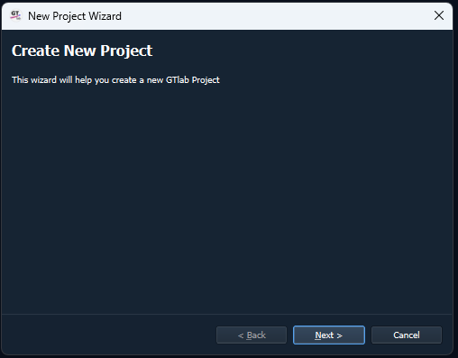
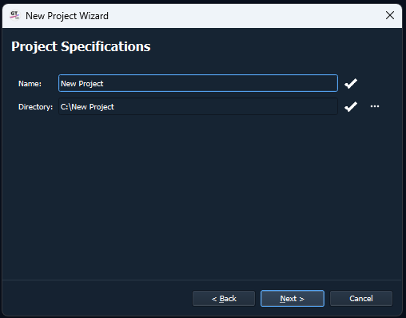
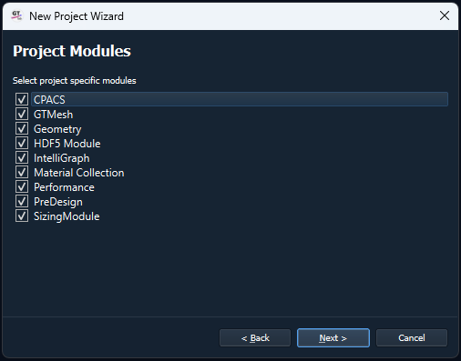
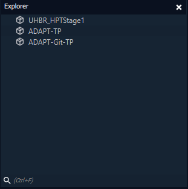
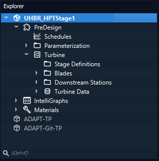
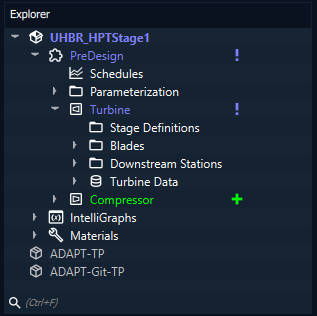
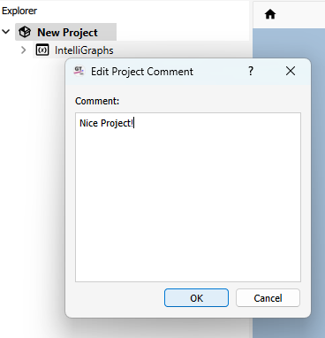
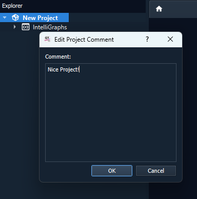
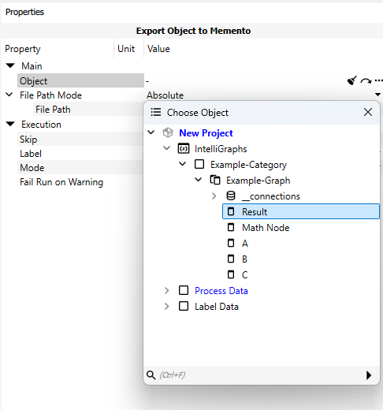
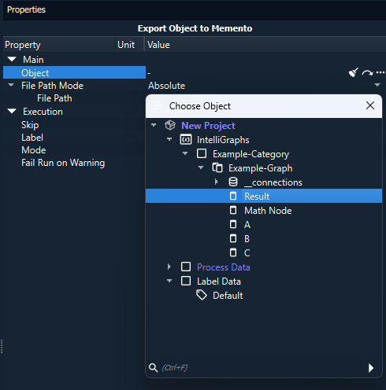

.. _label_chapter_projects:

Projects
========

In GTlab, work is organised in the form of projects.
This means that a project contains all data, both for the modelling of objects and systems, as well as all information on workflows and similar.
They are therefore the superordinate element of data handling.

The following section shows how to create new projects, change or delete projects, but also how the data is organised within a project and how it can be handled.

Project Handling
----------------

Create a new project
^^^^^^^^^^^^^^^^^^^^
To set up a new project in your current session, use the **New Project Wizard**.

Start the wizard from the menu ``File → New Project`` or via the toolbar. The wizard will guide you step by step through the required settings.

On the **Project Specifications** page, enter a project name (*Name*) and choose a storage location (*Directory*) on your file system.

The project name must be unique within the session. In addition, you cannot select a directory that already contains a GTlab project file.

On the **Project Modules** page, select the modules whose module packages you
want in the new project. Only modules with a valid data model are available
for selection.

Click *Next* to confirm your selection. To finalize the setup, choose *Finish* on the *Import Data* page.

Edit module packages
^^^^^^^^^^^^^^^^^^^^
Right-click an open project in the Explorer and choose *Add Module Package*,
directly above *Open Project Settings...*. Select a module from the submenu
to create or restore its module package. The submenu lists loaded modules
that provide a module package and have none in this project.

If the current project folder already contains a saved module package for the
selected module, GTlab offers *Restore Existing Module Package*,
*Create Empty Module Package*, and *Cancel*. Restoring loads the last saved
data and retains the original object UUIDs. GTlab checks for required module
upgrades. If the file has no module version, GTlab asks you to confirm before
reading its contents.

Right-click a module package and choose *Delete*, or select it and press
*Delete*. Confirm to remove the module package and its contents from the project.
Other project objects keep their references. While the edit is in the undo
history, *Undo* restores the module package and its unsaved changes in the
object tree.

Use *Save Project* to save your changes. Deleting a module package leaves its
saved files on disk. If you choose *Create Empty Module Package*, the next
successful save replaces the retained ``.gtmod`` file with the new data. The
module continues to manage its own auxiliary files.

Module packages can be edited only while no task is running.

.. _label_section_sessions:

Sessions
^^^^^^^^
Sessions are an easy way to sort projects. Selecting the current session or creating new sessions etc. is possible in the :ref:`Preferences <label_chapter_preferences_session>`.
Any number of projects can be collected in a session, whereby only one project can be open at a time.

Project Explorer
----------------

The :ref:`Project Explorer  <label_project_explorer>` displays the project data in a tree structure. The top level shows the projects of the active session.

Closed projects are marked accordingly, while the open project is highlighted in bold. Only one project can be open in a GTlab instance at a time. To work with multiple projects, you must open additional GTlab instances. Copying data between instances is supported.

The context menu (right‑click) adapts depending on whether a project is open or closed. For example:

- *Open Project*: Opens a project. If another project is already open, it will be closed automatically.
- *Rename Project*: Renames a closed project without changing its file path.
- *Delete from Session*: Removes a closed project from the active session (optionally deleting it from the file system).
- *Show in Explorer*: Opens the project’s folder in the file explorer.

For open projects, the menu includes *Save Project*, *Save Project As…*,
*Close Project*, and *Add Module Package*.

Module packages appear directly below the project in the tree. A module
package can contain models, geometry, or result objects, depending on the
module's data model. Use *Ctrl+F* to filter the data objects.

When selecting a data object, its properties are shown in the :ref:`Properties Dock <label_property_dock>`. Changes to objects are indicated with symbols and color coding in the Explorer:

- Modified objects are highlighted in blue with a change symbol.
- Newly added objects appear in green with a plus symbol.
- Once the project is saved, symbols and colors are updated accordingly.

Project Comments
^^^^^^^^^^^^^^^^
GTlab offers the option of adding a text comment to a project.
You can access the editor via the *Edit Comment* entry in the project's `context menu`_.

Whether a project has a comment is indicated by a small speech bubble icon next to the project name. The comment appears as a tooltip when the mouse is held over this icon.

Project Settings
^^^^^^^^^^^^^^^^
The **Project Settings** dialog can be accessed via the `context menu`_ of a project in the Explorer.

Footprint Information
^^^^^^^^^^^^^^^^^^^^^
The **Footprint Information** dialog can be accessed via the `context menu`_ of a project in the Explorer.

Context menu
^^^^^^^^^^^^

The context menu of a project is the access point for many of the actions mentioned and for others.

.. list-table::
   :header-rows: 1
   :widths: 30 70

   * - Action
     - Description
   * - *Open Project*
     - Opens a closed project.
   * - *Close Project*
     - Closes an open project.
   * - *Save Project*
     - Saves the current state of the project.
   * - *Save Project As...*
     - Saves the current project at a different location with a different name and opens this copy in the explorer.
   * - *Add Module Package*
     - Opens a submenu of modules for which you can create an empty module package or restore saved data from this project.
   * - *Open Project Settings...*
     - Opens the dialog of the `Project Settings`_.
   * - *Show Project Footprint*
     - Opens the dialog of the `Footprint Information`_.
   * - *Edit Comment*
     - Opens the dialog to edit `Project Comments`_.
   * - *Show in Explorer*
     - Opens the folder in the computer file system containing the project file.
   * - *Rename Project*
     - Opens a dialog to rename a project. Only possible for closed projects.
   * - *Delete from Session*
     - Deletes project from session. Only possible for closed projects. The following dialog also offers the option of removing the project completely from the computer.
   * - *Generate Backup*
     - Generates a backup.
   * - *Restore Backup*
     - Opens the dialog to restore a backup. Only possible if at least one backup of the project exists.

Project Data
------------

.. _label_section_packages:

Module Packages
^^^^^^^^^^^^^^^
A module package holds a module's data for this project. It appears directly
below the project in the data tree. Modules can also provide workflow
elements that are available independently of the project's module packages.

.. _label_section_properties:

Properties
^^^^^^^^^^
In GTlab, the properties of data model objects and thus also workflow elements can be described using a large selection of properties.
The properties can be of many different types, e.g. as numerical values, texts, path specifications to files, object references and many more.

Brief explanations of some more specific elements and features follow.

Object Selection
""""""""""""""""
Object references play an important role in the properties and settings of workflow elements in particular, but also in the project data model. Processes often require data records or data objects on the basis of which simulations are carried out, for example.

There is a separate dialog for this in the properties of elements that work via such a reference.

Such a property shows the value "-" if it is not yet set. Clicking on the button with the three dots (...) opens the dialog for selecting an object that is to be referenced.
Depending on the purpose of the reference, only the selection of meaningful objects is possible in this object.

Clicking on the broom symbol resets the reference. The button with the curved arrow allows the object referenced here to be selected in the Explorer widget.

Unit System
"""""""""""
Many properties of data model elements are described using floating point numbers.
GTlab supports a system of units for these. This means that you can switch between the usual units for the parameter.
For example, temperatures are specified in the SI unit *K* (Kelvin), but can also be switched to *°C* (Celsius) via the user interface.
This can be done by clicking on the unit.
If different options are available, a drop-down menu opens from which an alternative unit can be selected.
If the unit is changed, the corresponding numerical value is automatically converted.
The units used are not saved, so the unit is always switched back to the SI unit when the selection of the object with the property is cancelled.
